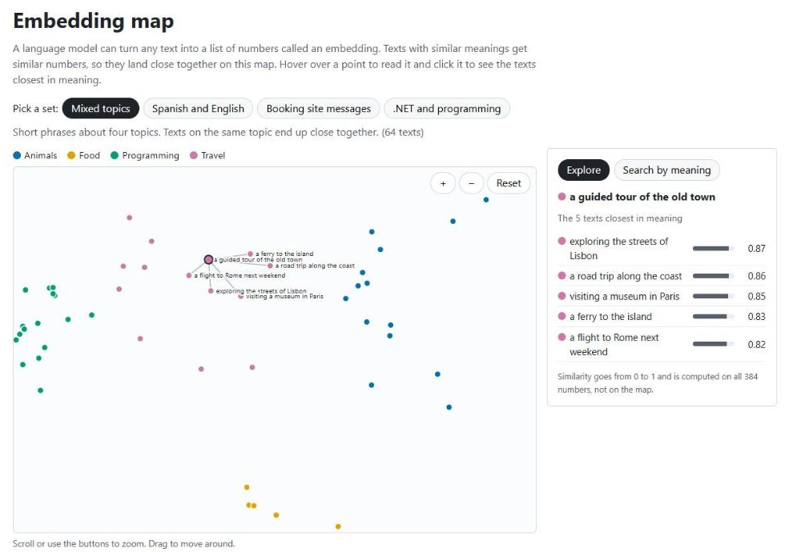

# Embedding map

A web page that shows what an embedding is: the list of numbers a language model turns a text into, so that texts
with similar meanings get similar numbers. Pick a set of texts and see them on a map, with similar meanings close
together. Click one to see the five texts closest in meaning, or search the set by meaning. It runs entirely in the
browser with Blazor WebAssembly.

**Try it:** https://robmardeveloper.github.io/embedding-map/



## What it shows

- **A map of each set.** Every text is a point, colored by its group. Hover over a point to read it. Zoom with the
  mouse wheel or the buttons and drag to move around.
- **The five closest texts.** Click a point and the panel lists the five texts closest in meaning, each with its
  similarity from 0 to 1. Lines join them on the map.
- **Search by meaning.** Pick any text and the whole set is ranked by similarity to it. Weaker matches fade on the map.
- **A short explanation** under the map: what an embedding is, how similarity is measured and why a flat map loses
  information.

## What the sets show

There are four sets of 60 to 64 texts each, all written for this page:

| Set | Texts | What to look for |
| --- | ---: | --- |
| Mixed topics | 64 | Animals, food, programming and travel form four clear groups. |
| Spanish and English | 64 | The same 32 words in both languages. |
| Booking site messages | 60 | Six kinds of customer messages, mixed in Spanish and English. |
| .NET and programming | 60 | Terms from web, data, testing, the C# language and tooling. |

Measured on these sets:

- **Meaning crosses languages.** For 55 of the 64 words the closest text is the translation. For 60 of them it is in
  the top three.
- **Wording matters less than meaning.** "No me ha llegado el email de la reserva" and "Falta la confirmación de mi
  reserva" share almost no words, yet their similarity is above 0.9.
- **Clear topics separate well, close ones less so.** Of the five closest texts, 87% share the group in the mixed
  topics set. In the booking and .NET sets it is about half, because the groups overlap in meaning.
- **The scores are squeezed together.** With this model even unrelated texts usually score above 0.7, and single
  words often above 0.85. "doctor" and "médico" score 0.94, but "doctor" and "dog" still score 0.89. The order of the
  results and the gap after the first ones say more than the number itself.

## How it works

The solution has three projects:

- **`EmbeddingMap.Core`**, plain C# with no dependencies: cosine similarity, ranking the nearest texts, principal
  component analysis (PCA) to go from 384 numbers to two, and fitting the points into the map.
- **`EmbeddingMap.Web`**, the Blazor WebAssembly page. It loads the precomputed numbers and calls Core. Zoom and drag
  are written in C# too. The only JavaScript is a one-line helper that reads where the map is on screen.
- **`EmbeddingMap.Generator`**, a console tool that runs only on the developer's machine. It computes the embeddings
  with [ONNX Runtime](https://onnxruntime.ai/) and writes the JSON files the page loads.

Some decisions worth explaining:

- **The embeddings are computed ahead of time.** The model is 470 MB, far too big for a page that should load in
  seconds. The generator runs it once and saves 384 numbers per text, rounded to four decimals. Each set is about
  50 KB once compressed.
- **The map and the list use different numbers.** The map has to squeeze 384 numbers into two and keeps only part of
  the variation (between 11% and 19% depending on the set). The list of closest texts uses all 384. When they
  disagree, the list is right.
- **The bars are relative, the numbers are not.** Bars from 0 to 1 would all look the same, since almost every score
  falls between 0.7 and 0.95. So each bar stretches between the weakest and the strongest match for the selected
  text, which makes a clear winner stand out. The number next to it is still the real similarity.
- **PCA is written by hand, without a maths library.** The sets are small, so it works on the n×n matrix of products
  between texts and finds the two main directions by power iteration. A fixed starting vector keeps the map the same
  on every visit.
- **The tokenizer in .NET needed an offset.** The generator splits text with
  [Microsoft.ML.Tokenizers](https://www.nuget.org/packages/Microsoft.ML.Tokenizers), which returns the raw
  SentencePiece IDs. This model expects every ID shifted by one, as its original Python tokenizer does. Without the
  shift the numbers come out wrong with no error at all, so the tests check that translations still come out next
  to each other.

## How the embeddings were generated

1. Download `onnx/model.onnx` and `sentencepiece.bpe.model` from
   [intfloat/multilingual-e5-small](https://huggingface.co/intfloat/multilingual-e5-small) into a folder outside the
   repository. By default the generator looks in `%LOCALAPPDATA%\embedding-models\multilingual-e5-small`.
2. Run `dotnet run --project tools/EmbeddingMap.Generator`. It takes a few seconds.

For each text the generator adds the `query: ` prefix the model expects, runs the model, averages the output over the
tokens and scales the result to length 1. The texts live in `tools/EmbeddingMap.Generator/Samples.cs`.

## Download size

Everything the page needs comes down to the browser on the first visit. Measured on the Release build:

- **2.3 MB** compressed with Brotli, 7.0 MB uncompressed.
- **2.7 MB** from GitHub Pages, which compresses with gzip, not Brotli.
- The first set is about 50 KB of that. Each other set adds about 50 KB when it is opened.

## Limits

- **One model.** The map shows what multilingual-e5-small thinks. A different model would give different numbers and
  a different map.
- **The map is a sketch.** Two points can look close and be far apart in 384 dimensions. In the Spanish and English set
  the map even splits the words by language, because that is the biggest difference it can show, while the list still
  finds the translation first.
- **Only the texts in the sets.** You cannot type your own text, because that would need the model in the browser.
- **Small sets on purpose.** PCA on the n×n matrix is fine for a hundred texts, not for a hundred thousand.

## Run it locally

You need the .NET 10 SDK.

```
dotnet run --project src/EmbeddingMap.Web
dotnet test --solution EmbeddingMap.slnx
```

## Credits

- The idea comes from the lesson
  [Embedding models](https://github.com/rohitg00/ai-engineering-from-scratch/tree/main/phases/05-nlp-foundations-to-advanced/22-embedding-models-deep-dive)
  of the course [AI Engineering from Scratch](https://github.com/rohitg00/ai-engineering-from-scratch) (MIT licence).
- Embeddings by [multilingual-e5-small](https://huggingface.co/intfloat/multilingual-e5-small) (MIT licence), run
  with [ONNX Runtime](https://github.com/microsoft/onnxruntime) (MIT licence).
- Tokenizer by [Microsoft.ML.Tokenizers](https://github.com/dotnet/machinelearning) (MIT licence).

## License

[MIT](LICENSE)
